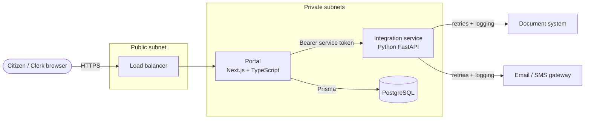

# Architecture

Locally, Docker Compose runs the same shape. The document system and the gateway are fake services in `mock-services/`.

## Responsibilities

| Component | Owns | Never does |
|---|---|---|
| Portal (Next.js) | UI, login, roles, request workflow, deadlines, audit log, the database | Talk to third-party systems directly |
| Integration service (FastAPI) | Validating, transforming and retrying calls to outside systems, and logging each call | Touch the database, serve the internet, duplicate portal CRUD |
| Postgres | Requests, users, documents metadata, audit trail | Accept connections from anything but the portal |

## Security boundaries

1. **Network.** Only the load balancer is public. The integration service has no public route, and only the portal's security group can reach it. Locally, the `internal` Compose network has no outside route and the service publishes no port.
2. **Service auth.** Every integration call needs a shared bearer token, compared in constant time. Even a caller on the private network is rejected without it.
3. **Input validation.** Request bodies reject unknown fields (`extra="forbid"`), and IDs are pattern-checked before they are put into upstream URLs.
4. **Output filtering.** Documents from the legacy DMS are normalized, and any file type outside an allowlist is dropped before it reaches the portal.
5. **Traceability.** An `X-Request-ID` header follows each user action from the portal through every upstream call, and logs are one JSON object per line.

## Request lifecycle

`submitted → in_review → fulfilled | denied`

Each status change writes an audit log row and sends a notification through the integration service. Requests past `due_at` that aren't closed get flagged as overdue on the clerk dashboard.
