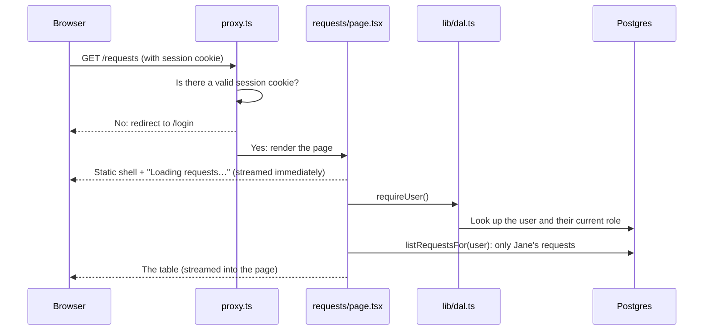
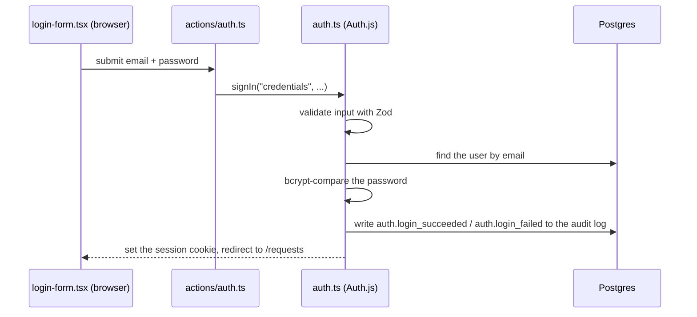

# 2. How the portal works

The portal in `app/` is a **Next.js** application. Next.js is a framework built on React. In PHP terms, it gives you routing, server-side rendering and form handling, much like Laravel does, but your pages are React components.

## The big idea: React that runs on the server

In a typical React app, components run in the browser and fetch data from an API. Here, **most components run on the server**, like a PHP script. They can query the database directly and send finished HTML to the browser.

| You know (PHP) | In this codebase | Runs where |
|---|---|---|
| `requests.php` that queries MySQL and echoes HTML | A **Server Component**: `src/app/requests/page.tsx` | Server |
| The script that handles `$_POST` from a form | A **Server Action**: a function in a file marked `"use server"` | Server |
| jQuery or React in the browser | A **Client Component**: a file marked `"use client"` | Browser |
| `.htaccess` rules or a front controller check | **Proxy**: `src/proxy.ts` | Server, before every request |
| `$_SESSION` | An encrypted session cookie managed by **Auth.js** | Cookie, decoded on the server |
| PDO or Eloquent | **Prisma** (see [the database chapter](3-database.md)) | Server |

**Components are Server Components unless the file starts with `"use client"`.** Use a Client Component only when you need browser things: `useState`, `onClick`, `useActionState` for form feedback, reading the URL in the browser. Keep it small, and let Server Components do the data work.

Server Components can't use `useState` or event handlers. Client Components can't query the database or import server-only files. The `import "server-only"` line at the top of files in `src/lib/` makes the build fail if someone tries.

## Where things live

```
app/
├── prisma/
│   ├── schema.prisma          ← the database tables (chapter 3)
│   ├── migrations/            ← SQL that creates or changes the tables
│   └── seed.ts                ← fake demo data
├── src/
│   ├── app/                   ← ROUTES: folders here become URLs
│   │   ├── layout.tsx         ← the shell around every page (header, footer)
│   │   ├── page.tsx           ← /            (home)
│   │   ├── login/page.tsx     ← /login
│   │   ├── requests/page.tsx  ← /requests
│   │   ├── admin/users/page.tsx ← /admin/users
│   │   ├── actions/           ← server actions (form handlers)
│   │   └── api/auth/...       ← Auth.js's own endpoints; don't touch
│   ├── components/            ← reusable UI pieces (badges, user menu)
│   ├── lib/                   ← server-side logic: data access, rules, helpers
│   ├── auth.ts, auth.config.ts← login configuration
│   ├── proxy.ts               ← runs before every request
│   └── generated/prisma/      ← created by `prisma generate`; never edit, not in Git
├── Dockerfile
└── package.json
```

### Routing: folders are URLs

The file-based routing should feel familiar from PHP: `src/app/requests/page.tsx` serves `/requests`, the way `requests.php` would. Only files named `page.tsx` become pages. Other files in the folder are private helpers.

| File | URL |
|---|---|
| `src/app/page.tsx` | `/` |
| `src/app/requests/page.tsx` | `/requests` |
| `src/app/requests/new/page.tsx` | `/requests/new` (you build this in chapter 4) |
| `src/app/requests/[id]/page.tsx` | `/requests/abc123`, where `[id]` is a URL parameter, like `$_GET['id']` (also chapter 4) |

`layout.tsx` wraps every page below it, like a PHP header and footer include.

## The life of a page request

What happens when Jane opens `/requests`:



1. **[proxy.ts](../../app/src/proxy.ts)** runs first. It only checks the cookie, with no database lookup, so it's fast. Signed out? Redirect to `/login`. Not an admin on an `/admin` page? Redirect away. The rules live in the `authorized` callback in [auth.config.ts](../../app/src/auth.config.ts).
2. **The page renders.** Next.js sends the parts that are the same for everyone first (the header, the "Loading…" message). This is the *static shell*.
3. **Inside a `<Suspense>` boundary**, the component that needs the user runs:

   ```tsx
   // src/app/requests/page.tsx (simplified)
   export default function RequestsPage() {
     return (
       <Suspense fallback={<p>Loading requests…</p>}>
         <RequestsTable />
       </Suspense>
     );
   }

   async function RequestsTable() {
     const user = await requireUser();               // who is this? (from the DB)
     const requests = await listRequestsFor(user);   // only what they may see
     return <table>...</table>;
   }
   ```

4. The finished table streams into the page, replacing the "Loading…" message.

Notice that a Server Component can be an **`async` function** that `await`s the database directly, with no `useEffect` and no fetch to an API.

## Security happens in three layers

This is the most important section in the guide. **Never rely on hiding a button.**

| Layer | Where | What it does | Can you skip it? |
|---|---|---|---|
| 1. Proxy | `src/proxy.ts`, `src/auth.config.ts` | Quick redirects based on the cookie | It's only a convenience. It's not security. |
| 2. Data access layer | `src/lib/dal.ts`: `requireUser()` | Loads the user **from the database** and checks their role | **No.** Every page component and server action that needs a user must call it. |
| 3. Scoped queries | `src/lib/requests.ts` | Every query filters by what the user may see | **No.** Put the rule in the query (`where: { requesterId: user.id }`), not in the page. |

Why the database lookup in layer 2? The session cookie says "Morgan is a clerk" for up to 8 hours. If an admin demotes Morgan, the cookie still says clerk, but `requireUser()` re-reads the role on every request, so the change applies immediately.

```ts
await requireUser();                   // any signed-in user, otherwise redirect to /login
await requireUser("admin");            // admins only, otherwise a 404 page
await requireUser("clerk", "admin");   // staff only
```

It returns a 404 rather than a "forbidden" error, so people can't tell which pages exist.

## How login works



- [login-form.tsx](../../app/src/app/login/login-form.tsx) is a Client Component, because it shows "Signing in…" and error messages.
- The `authorize` function in [auth.ts](../../app/src/auth.ts) checks the password. Passwords are stored as bcrypt hashes, never as plain text, as with PHP's `password_hash()` and `password_verify()`.
- If the email doesn't exist, it still runs a bcrypt check against a dummy hash, so a wrong email and a wrong password take the same time and show the same message. Attackers can't use the login form to find out who has an account.
- The session cookie holds only the user's ID and role, in encrypted form. It expires after 8 hours.

## The life of a form submission

Forms post to a **server action**: an `async` function in a `"use server"` file. Next.js turns it into an endpoint for you. You never write a fetch call or an API route.

```tsx
// A Client Component form
"use client";
const [state, formAction, pending] = useActionState(createRequest, undefined);
return <form action={formAction}> ... </form>;
```

```ts
// The server action, in a "use server" file
export async function createRequest(prev, formData: FormData) {
  const user = await requireUser("citizen");                // 1. who is asking?
  const parsed = schema.safeParse({ subject: formData.get("subject") }); // 2. validate
  if (!parsed.success) return { errors: ... };              //    send errors back to the form
  await prisma.$transaction(async (tx) => { ... });         // 3. save + audit, together
  redirect(`/requests/${id}`);                              // 4. send them somewhere
}
```

- `formData.get("subject")` is `$_POST['subject']`.
- Whatever the action returns shows up as `state` in the form, so `state.errors.subject` is how you display validation errors.
- `pending` is `true` while the action runs, so you can disable the button.
- **Treat every server action as a public endpoint.** Anyone can call it with any data, even without your form. Always call `requireUser()` and validate the input inside the action.

Validation uses **[Zod](https://zod.dev)**. You describe the shape you expect, and `safeParse` tells you whether the input matches:

```ts
const schema = z.object({
  subject: z.string().trim().min(5, "Give the request a short subject.").max(200),
});
```

[Chapter 4](4-tutorial-first-feature.md) builds a complete form from scratch.

## The audit log

Anything that changes data writes an audit entry with [recordAudit()](../../app/src/lib/audit.ts):

```ts
await recordAudit({
  action: "request.created",        // must be one of the AuditAction values in audit.ts
  actorId: user.id,
  entityType: "records_request",
  entityId: created.id,
  requestId: created.id,
}, tx);                             // pass the transaction so both save together
```

To log a new kind of event, add its name to the `AuditAction` type in `audit.ts` first. TypeScript will then reject typos.

The database itself refuses to update or delete audit rows (see [chapter 3](3-database.md#the-audit-log-is-append-only)), so never write code that tries.

## The rules of Cache Components (read this before your first page)

This project uses Next.js 16 with **Cache Components** turned on. Next.js pre-builds the parts of each page that are the same for every visitor. That makes pages fast, but it brings two rules. Break them and you'll see errors like *"Next.js encountered the unstable value `crypto.getRandomValues()` while prerendering"*, or build errors about data being read outside `<Suspense>`.

**Rule 1: anything that depends on the request goes inside `<Suspense>`.** That includes the current user, database queries, cookies and URL parameters (`params`, `searchParams`). The pattern is always the same: a small page component that returns a `<Suspense>`, and an `async` component inside it that does the work. Copy it from `requests/page.tsx`.

**Rule 2: get the user through `requireUser()` or `getCurrentUser()`.** They call `await connection()` first, which tells Next.js "this is per-request work, don't pre-build it". Calling `auth()` directly from a page can trigger the "unstable value" error.

A side effect of streaming: when a page calls `notFound()` inside `<Suspense>`, the browser gets status **200** with the "not found" page, not a 404 status. The headers were already sent with the shell. The page content is still correct and is marked so search engines don't index it.

> This Next.js version is newer than most tutorials online. When something you read doesn't match, trust the official docs bundled with the project, in `app/node_modules/next/dist/docs/`.

## Styling

Styling uses **Tailwind CSS**: you style elements with utility classes, like `className="rounded border px-4 py-2"`, instead of writing CSS files. The colors are named tokens defined once in [globals.css](../../app/src/app/globals.css), with dark-mode versions:

| Class | Use for |
|---|---|
| `bg-background`, `bg-surface` | Page background, cards and tables |
| `text-foreground`, `text-muted` | Normal text, secondary text |
| `border-line` | Borders and dividers |
| `bg-accent`, `text-accent`, `hover:bg-accent-strong` | Buttons and links |
| `text-danger`, `bg-danger` | Errors, overdue warnings |

Use these instead of raw colors like `text-blue-600`, so dark mode keeps working. Copy the button, input and table classes from existing pages to stay consistent.

**Next:** [3. The database](3-database.md)
