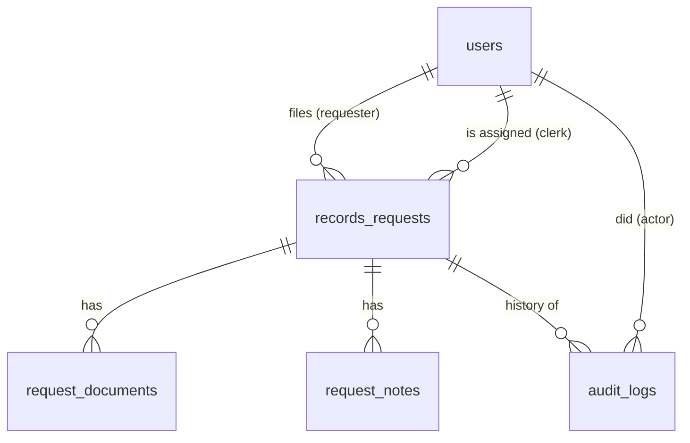

# 3. The database

The database is **PostgreSQL**. If you know MySQL, it'll feel familiar: the SQL is nearly the same. The portal doesn't write SQL by hand. It uses **Prisma**, which turns a schema file into typed TypeScript functions.

## The tables



| Table | Holds | Notes |
|---|---|---|
| `users` | Everyone who can sign in | `role` is `citizen`, `clerk` or `admin`. Passwords are bcrypt hashes. |
| `records_requests` | Each records request | `status` is `submitted`, `in_review`, `fulfilled` or `denied`. `due_at` is 10 business days after `submitted_at`. `closed_at` is set when fulfilled or denied. |
| `request_documents` | Files attached to a request | Citizens only see rows where `is_released` is true. |
| `request_notes` | Internal staff notes | **Never** show these to citizens. |
| `audit_logs` | Who did what, and when | Append-only (see below). |

## Reading the schema file

Everything is defined in [app/prisma/schema.prisma](../../app/prisma/schema.prisma). Here's part of one model, annotated:

```prisma
model RecordsRequest {
  id              String        @id @default(cuid())         // primary key, random ID like "cmwwq16cn0003..."
  referenceNumber String        @unique @map("reference_number") // human ID: PRR-2026-0001
  status          RequestStatus @default(submitted)          // an enum (see `enum RequestStatus`)
  requesterId     String        @map("requester_id")         // foreign key column
  assignedClerkId String?       @map("assigned_clerk_id")    // ? = nullable
  dueAt           DateTime      @map("due_at")

  requester     User  @relation("Requester", fields: [requesterId], references: [id])  // the joined row
  assignedClerk User? @relation("AssignedClerk", fields: [assignedClerkId], references: [id])
  documents     RequestDocument[]                            // one-to-many

  @@index([status, dueAt])          // a database index
  @@map("records_requests")         // the real table name
}
```

- **Names:** code uses `camelCase` (`dueAt`), and the database uses `snake_case` (`due_at`). `@map` connects the two. Use the camelCase name in TypeScript and the snake_case name in raw SQL.
- **Relation fields** like `requester` and `documents` aren't columns. They let you pull in related rows, like a JOIN.

## Querying with Prisma

Import the shared client from `@/lib/prisma`, and only in server code.

| What you want | PHP / SQL | Prisma |
|---|---|---|
| One row by unique field | `SELECT * FROM users WHERE email = ?` | `prisma.user.findUnique({ where: { email } })` |
| First matching row | `... WHERE id = ? AND requester_id = ? LIMIT 1` | `prisma.recordsRequest.findFirst({ where: { id, requesterId: user.id } })` |
| Many rows, sorted | `... ORDER BY due_at ASC` | `prisma.recordsRequest.findMany({ orderBy: { dueAt: "asc" } })` |
| Only some columns | `SELECT id, subject ...` | `select: { id: true, subject: true }` |
| Join | `JOIN users ON ...` | `select: { requester: { select: { name: true } } }` |
| Count | `SELECT COUNT(*) ...` | `prisma.recordsRequest.count({ where: { status: "submitted" } })` |
| Insert | `INSERT INTO ...` | `prisma.requestNote.create({ data: { body, requestId, authorId } })` |
| Update | `UPDATE ... SET status = ?` | `prisma.recordsRequest.update({ where: { id }, data: { status: "in_review" } })` |

A real example from [src/lib/requests.ts](../../app/src/lib/requests.ts):

```ts
return prisma.recordsRequest.findMany({
  where: isStaff(user) ? {} : { requesterId: user.id },   // citizens: only their own
  orderBy: { dueAt: "asc" },
  select: {
    id: true,
    subject: true,
    status: true,
    requester: isStaff(user) ? { select: { name: true } } : false,  // names only for staff
  },
});
```

Every query returns a Promise, so always `await` it. The result is fully typed: hover over it in VS Code to see exactly which fields you selected.

**Always use `select`** to pick the columns you need, especially from `users`. It stops sensitive fields like `passwordHash` from ever reaching a page.

**Don't build SQL strings.** Prisma escapes every value for you, so SQL injection isn't possible through these functions. If you truly need raw SQL, use `prisma.$queryRaw` with the template-literal form, which still escapes values. Never use `$queryRawUnsafe` with user input.

### Transactions

When two writes must succeed or fail together, as a change and its audit entry must, use a transaction:

```ts
await prisma.$transaction(async (tx) => {
  const created = await tx.recordsRequest.create({ data: { ... } });
  await recordAudit({ action: "request.created", ... }, tx);   // same transaction
});
```

Inside the callback, use `tx` instead of `prisma`. If anything throws, everything rolls back, like PDO's `beginTransaction()` and `rollBack()`.

## Changing the schema

Say you want to add a `phone` column to `users`:

1. **Edit** `app/prisma/schema.prisma`:

   ```prisma
   phone String? @map("phone")
   ```

2. **Create and apply a migration.** The database must be running (`docker compose up -d db`):

   ```bash
   cd app
   npm run db:migrate -- --name add_user_phone
   ```

   This writes a new SQL file in `prisma/migrations/` and runs it on your local database. **Open the SQL file and read it.** It's the exact change that will run in production.

3. **Regenerate the TypeScript client** so your editor knows about the new field:

   ```bash
   npm run db:generate
   ```

   If VS Code still underlines the new field, run **TypeScript: Restart TS Server** from the command palette (Ctrl+Shift+P).

4. **Commit** the schema change *and* the migration folder together.

The Docker `migrate` container runs `prisma migrate deploy` on every start, so anyone who pulls your change just runs `docker compose up --build`.

**Never edit a migration that's already committed.** Other people's databases have already run it. Make a new migration instead.

New required columns need a value for rows that already exist. Either make the column optional (`String?`) or give it a `@default(...)`.

## The audit log is append-only

The first migration adds a Postgres **trigger** that rejects every `UPDATE` and `DELETE` on `audit_logs`:

```
ERROR:  audit_logs is append-only (UPDATE rejected)
```

This is deliberate: an audit trail that can be edited proves nothing. If you get this error, your code is trying to change history. Write a new audit row instead.

## Demo data

[app/prisma/seed.ts](../../app/prisma/seed.ts) creates the 5 demo users and 7 requests. Every person and record in it is fake.

- **In Docker**, the seed runs on first start and skips itself if the database already has users.
- **On your machine**, `npm run db:seed` **wipes everything** and reloads the demo data.
- To reset Docker's database completely: `docker compose down -v`, then `docker compose up --build`.

If you add a table or column, consider adding demo data for it to `seed.ts`, so other developers see your feature with realistic data.

## Looking at the data directly

Open a SQL prompt inside the database container:

```bash
docker compose exec db psql -U prrp -d records_portal
```

Then try:

```sql
\dt                                                   -- list tables
SELECT email, role FROM users;
SELECT reference_number, status, due_at FROM records_requests ORDER BY due_at;
SELECT action, created_at FROM audit_logs ORDER BY id DESC LIMIT 10;
\q                                                    -- quit
```

(If you set your own `POSTGRES_USER` or `POSTGRES_DB` in `.env`, use those values instead.)

**Next:** [4. Tutorial: your first feature](4-tutorial-first-feature.md)
