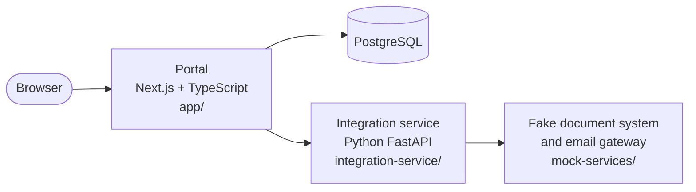

# Developer guide

This guide is for developers joining the project who know **React** and **PHP** but haven't worked with TypeScript, Next.js or Prisma. Read it in order the first time. After that, use the cheat sheet.

| # | Read | What you'll learn | Time |
|---|---|---|---|
| 1 | [JavaScript and TypeScript for PHP developers](1-typescript-for-php-developers.md) | The syntax you'll meet in this codebase, explained next to the PHP you already know | 30 min |
| 2 | [How the portal works](2-how-the-portal-works.md) | What happens when someone opens a page or submits a form, and where each kind of code lives | 45 min |
| 3 | [The database](3-database.md) | The tables, how to query them with Prisma, and how to change the schema | 30 min |
| 4 | [Tutorial: your first feature](4-tutorial-first-feature.md) | Build a request detail page and a "new request" form, step by step | 1–2 hours |
| 5 | [The integration service](5-integration-service.md) | The internal Python service and how the portal will use it | 20 min |
| 6 | [Cheat sheet and troubleshooting](6-cheat-sheet.md) | Commands, where things go, and fixes for errors you'll probably hit | Reference |

## The project in 60 seconds

It's a **public records request portal**. Citizens ask a city government for records, such as a police report or council emails. Clerks review each request and must answer within 10 business days. Every action is written to an audit log that can't be edited.



- **The portal** (`app/`) is where almost all feature work happens. It renders the pages, handles logins and forms, and is the only part that talks to the database.
- **The integration service** (`integration-service/`) is a small internal Python API that talks to outside systems, like an email gateway, with retries and logging. The public internet can't reach it.
- **The mock services** (`mock-services/`) pretend to be those outside systems, so everything runs on your laptop.

## Get it running first

You only need Docker Desktop:

```bash
docker compose up --build
```

Open http://localhost:3000 and sign in as `jane.citizen@example.com` (a citizen) or `morgan.clerk@example.org` (a clerk). The password is `demo-password-local-only`. Click around as both users before you read further: the rest of the guide will make more sense.

To change code and see it update instantly, use the hot-reload setup in the [cheat sheet](6-cheat-sheet.md#day-to-day-development).
